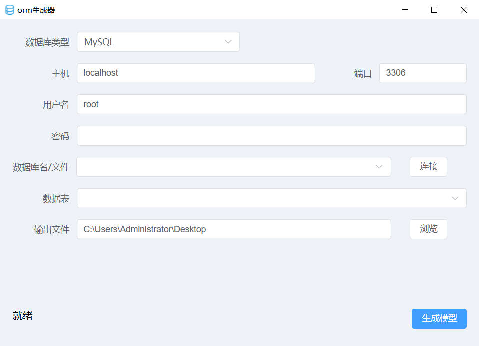

# orm_create
这是一个数据库表生成python sqlalchemy类型的orm模型类的工具

使用的是pywebview做GUI界面，采用前后端分离技术实现，前端项目在front-end文件夹，后端项目在backend文件夹
核心使用python sqlacodegen库实现orm模型代码生成
支持选择多个数据表，生成一个python文件
pyinstaller打包后的程序启动时间大约5秒
支持的数据库：
- mysql
- sqlite

使用场景：
- 服务器数据库模型类映射，如FastAPI

  
支持的操作系统：
- windows10
- 其它系统未测试

支持的python版本：
- python3.13.15
- 其它版本未测试

